# 無障礙申請自我評量項目

**無障礙網站空間服務網**：https://accessibility.moda.gov.tw/Home/Login

---

## 會員登入說明

1. **若為政府機關**，應以「我的E政府會員之公務帳號」提出申請
2. **若為民間團體**可以「E政府會員」或「本站會員」提出申請

### E政府會員登入
- 使用「我的E政府」平台
- 客服專線：02-2192-7111
- 前往[E政府單一登入網頁（另開視窗）](https://accessibility.moda.gov.tw/Home/Login)

### 本站會員登入
- 帳號
- 密碼
- 驗證碼
- [加入會員](https://accessibility.moda.gov.tw/Home/Login) | [忘記密碼](https://accessibility.moda.gov.tw/Home/Login)

---

## 會員專區功能

登入後可使用以下功能：

### 網站專區
- 申請網站標章
- 我的網站標章
- 我的機關網站
- 登錄網站資訊

### APP專區
- 申請APP標章
- 我的機關APP
- 登錄APP資訊

### 資料專區
- 相關資料管理

---

## 申請標章所需資料

### 必填欄位（標示紅色星號）
- **申請人聯絡電話**
- **申請人聯絡信箱**
- **標章機關代碼**：查詢機關代碼
- **網站名稱**
- **網址**
- **標章等級**：A、AA 或 AAA
- **Freego檢測報告上傳編號**：必填欄位，請輸入檢測程式所在資料夾中保存的上傳編號

### 選填欄位
- 申請人
- 機關代碼或統一編號
- 標章機關名稱
- 備註

### 注意事項
- Freego檢測報告上傳編號為必填欄位
- 如有其他項目需要填寫可於備註欄位留言
- 我的網站有部份或是需要登入後才能瀏覽的內容，我同意提供測試帳號讓檢測人員使用
- 為提供訪客可以反應網站問題的溝通管道，我同意在標章資訊公開以下聯繫方式

---

## Step 02：選擇網站使用的網頁設計類型（可複選）

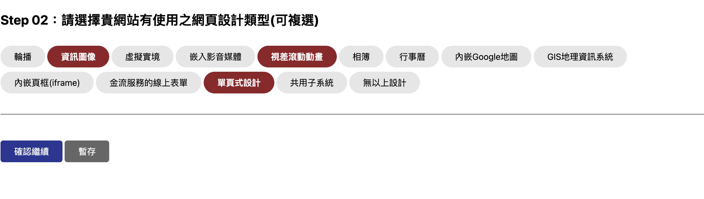

申請時需選擇貴網站有使用之網頁設計類型：

- 輪播
- 資訊圖像
- 虛擬實境
- 嵌入影音媒體
- 視差滾動動畫
- 相簿
- 行事曆
- 內嵌Google地圖
- GIS地理資訊系統
- 內嵌頁框（iframe）
- 金流服務的線上表單
- 單頁式設計
- 共用子系統
- 無以上設計

**操作**：確認繼續 | 暫存

---

## 自我評量項目

**注意**：實際順序會有所不同

---

## Q1：圖片

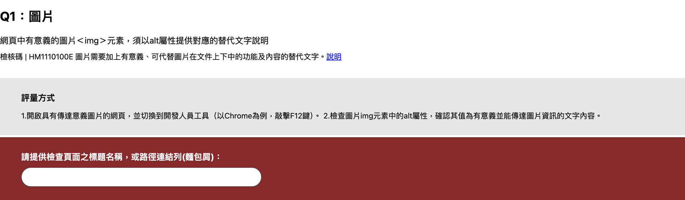

**評量項目**：網頁中有意義的圖片  元素，須以 alt 屬性提供對應的替代文字說明

**檢核碼**：HM1110100E

**說明**：圖片需要加上有意義、可代替圖片在文件上下中的功能及內容的替代文字

### 評量方式
1. 開啟具有傳達意義圖片的網頁，並切換到開發人員工具（以 Chrome 為例，啟動 F12 鍵）
2. 檢查圖片 img 元素中的 alt 屬性，確認其值為有意義並能傳達該圖片資訊的文字內容

---

## Q2：圖片

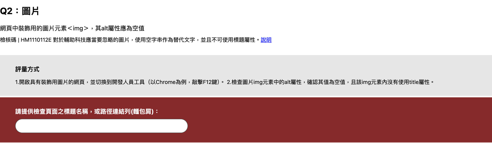

**評量項目**：網頁中裝飾用的圖片元素 ，其 alt 屬性應為空值

**檢核碼**：HM1110112E

**說明**：對於輔助科技應當忽略的圖片，使用空字串作為替代文字，並且不可使用標題屬性

### 評量方式
1. 開啟具有裝飾用圖片的網頁，並切換到開發人員工具（以 Chrome 為例，啟動 F12 鍵）
2. 檢查圖片 img 元素中的 alt 屬性，確認其值為空值，且該 img 元素內沒有使用 title 屬性

---

## Q3：影音媒體

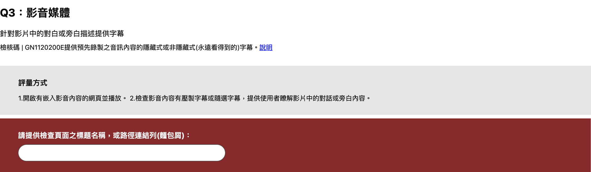

**評量項目**：針對影片中的對白或旁白描述提供字幕

**檢核碼**：GN1120200E

**說明**：提供預先錄製之音訊內容的隱藏式或非隱藏式（永遠看得到的）字幕

### 評量方式
1. 開啟有嵌入影音內容的網頁並播放
2. 檢查影音內容有壓製字幕或隨選字幕，提供使用者瞭解影片中的對話或旁白內容

---

## Q4：版面結構

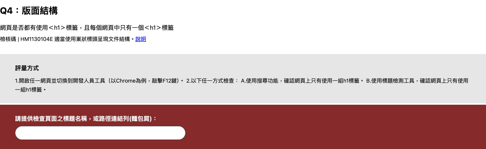

**評量項目**：網頁是否都有使用 <h1> 標籤，且每個網頁中只有一個 <h1> 標籤

**檢核碼**：HM1130104E

**說明**：適當使用巢狀標頭呈現文件結構

### 評量方式
1. 開啟任一網頁並切換到開發人員工具（以 Chrome 為例，啟動 F12 鍵）
2. 以下任一方式檢查：
   - A. 使用搜尋功能，確認網頁上只有使用一組 h1 標籤
   - B. 使用標題檢測工具，確認網頁上只有使用一組 h1 標籤

---

## Q5：版面結構

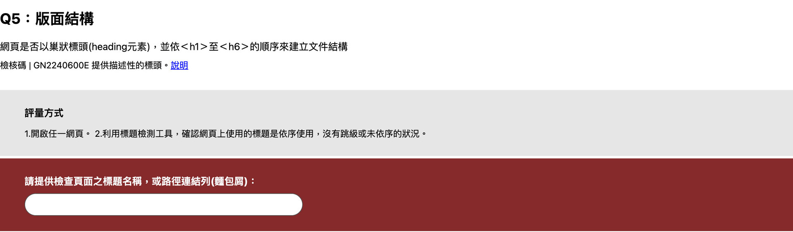

**評量項目**：網頁是否以巢狀標頭（heading 元素），並依 <h1> 至 <h6> 的順序來建立文件結構

**檢核碼**：GN2240600E

**說明**：提供描述性的標題

### 評量方式
1. 開啟任一網頁
2. 利用標題檢測工具，確認網頁上使用的標題是依序使用，沒有跳級或未依序的狀況

---

## Q6：鍵盤操作

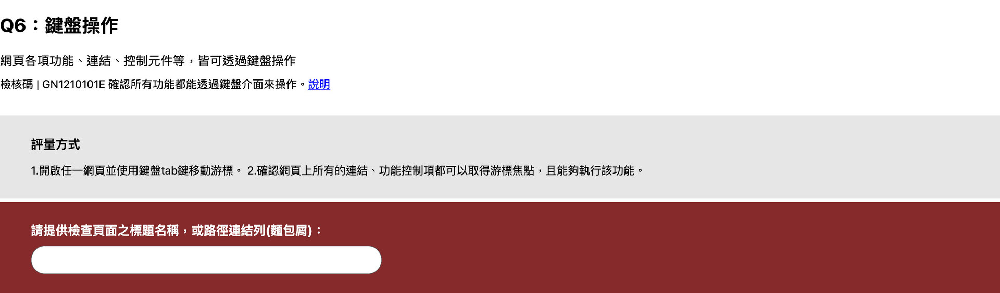

**評量項目**：網頁各項功能、連結、控制元件等，皆可透過鍵盤操作

**檢核碼**：GN1210101E

**說明**：確認所有功能都能透過鍵盤介面來操作

### 評量方式
1. 開啟任一網頁並使用鍵盤 tab 鍵移動游標
2. 確認網頁上所有的連結、功能控制項皆可以取得游標焦點，且能夠執行該功能

---

## Q7：鍵盤操作

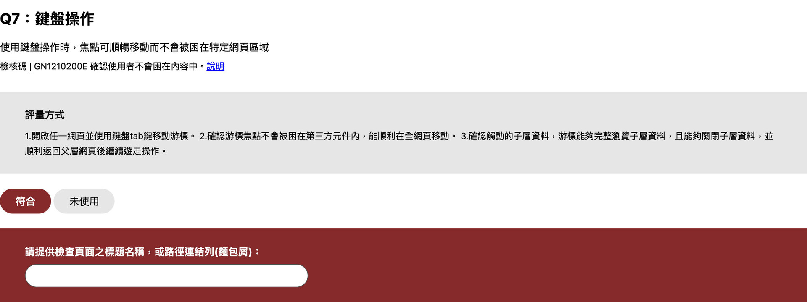

**評量項目**：使用鍵盤操作時，焦點可順暢移動而不會被困在特定網頁區域

**檢核碼**：GN1210200E

**說明**：確認使用者不會困在內容中

### 評量方式
1. 開啟任一網頁並使用鍵盤 tab 鍵移動游標
2. 確認游標焦點不會被困在第三方元件內，能順利在全網頁移動
3. 確認觸發的子層資料，游標能夠完整瀏覽子層資料，且能夠關閉子層資料，並順利返回父層網頁後繼續游走操作

---

## Q8：超連結

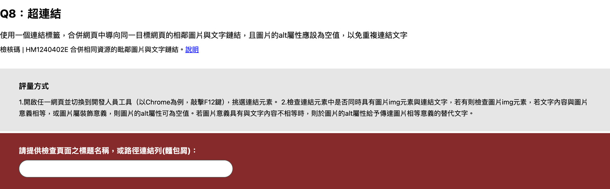

**評量項目**：使用一個連結標籤，合併網頁中導向同一目標網頁的相鄰圖片與文字連結，且圖片的 alt 屬性應設為空值，以免重複連結文字

**檢核碼**：HM1240402E

**說明**：合併相同資源的此鄰圖片與文字鍵結

### 評量方式
1. 開啟任一網頁並切換到開發人員工具（以 Chrome 為例，啟動 F12 鍵），挑選連結元素
2. 檢查連結元素中是否同時具有圖片 img 元素與連結文字，若有則檢查圖片 img 元素，若文字內容與圖片意義相屬，或圖片屬裝飾意義，則圖片的 alt 屬性可為空值。若圖片意義具有與文字內容不相等時，則於圖片的 alt 屬性給予傳達該圖片相等意義的替代文字

---

## Q8：檔案下載

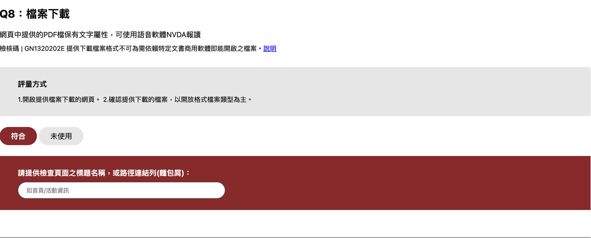

**評量項目**：網頁中提供的PDF檔保有文字屬性，可使用語音軟體NVDA報讀

**檢核碼**：GN1320202E

**說明**：提供下載檔案格式不可為需依賴特定文書商用軟體即能開啟之檔案

### 評量方式
1. 開啟提供檔案下載的網頁
2. 確認提供下載的檔案，以開放格式檔案類型為主

---

## Q9：導覽功能

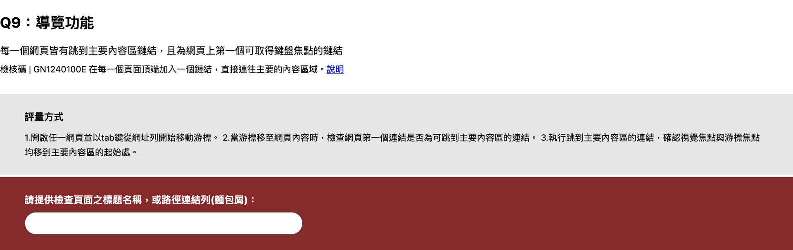

**評量項目**：每一個網頁皆有跳到主要內容區鍵結，且為網頁上第一個可取得鍵盤焦點的鍵結

**檢核碼**：GN1240100E

**說明**：在每一個頁面頂端加入一個鍵結，直接連往主要的內容區域

### 評量方式
1. 開啟任一網頁並以 tab 鍵從網址列開始移動游標
2. 當游標移至網頁內容時，檢查網頁第一個連結是否為可跳到主要內容區的連結
3. 執行跳到主要內容區的連結，確認視覺焦點與游標焦點均移到主要內容區的起始處

---

## Q10：導覽功能

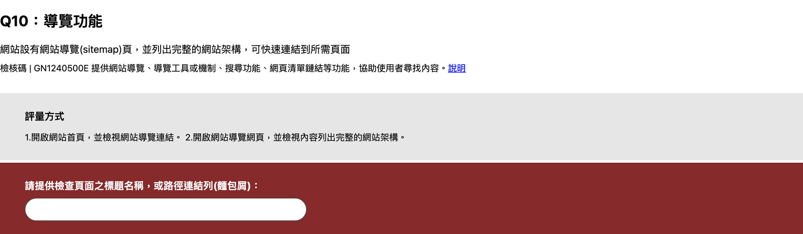

**評量項目**：網站設有網站導覽（sitemap）頁，並列出完整的網站架構，可快速連結到所需頁面

**檢核碼**：GN1240500E

**說明**：提供網站導覽、導覽工具或機制、搜尋功能、網頁清單鍵結等功能，協助使用者尋找內容

### 評量方式
1. 開啟網站首頁，並檢視網站導覽連結
2. 開啟網站導覽網頁，並檢視內容列出完整的網站架構

---

## Q11：導覽功能

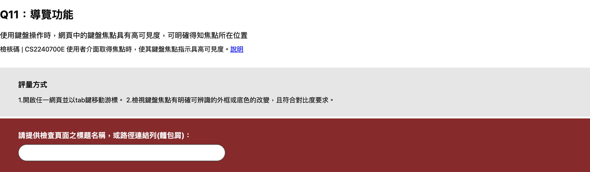

**評量項目**：使用鍵盤操作時，網頁中的鍵盤焦點具有高可見度，可明確得知焦點所在位置

**檢核碼**：CS2240700E

**說明**：使用者介面取得焦點時，使其鍵盤焦點指示具高可見度

### 評量方式
1. 開啟任一網頁並以 tab 鍵移動游標
2. 檢視鍵盤焦點有明確可辨識的外框或底色的改變，且符合對比度要求

---

## Q12：色彩對比

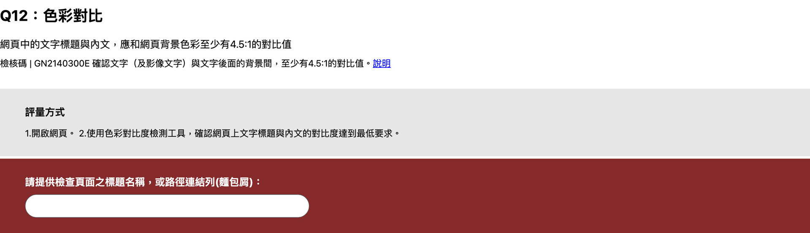

**評量項目**：網頁中的文字標題與內文，應和網頁背景色彩至少有 4.5:1 的對比值

**檢核碼**：GN2140300E

**說明**：確認文字（及影像文字）與文字後面的背景間，至少有 4.5:1 的對比值

### 評量方式
1. 開啟網頁
2. 使用色彩對比度檢測工具，確認網頁上文字標題與內文的對比度達到最低要求

---

## Q13：表單

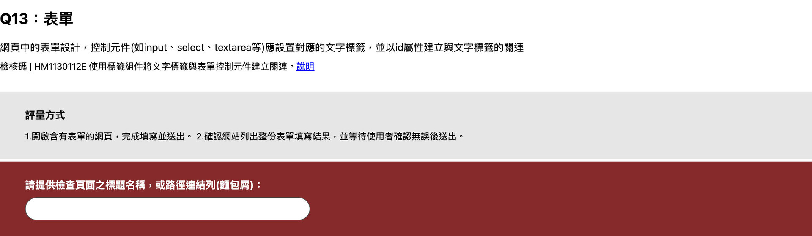

**評量項目**：網頁中的表單設計，控制元件（如 input、select、textarea 等）應設置對應的文字標籤，並以 id 屬性建立與文字標籤的關連

**檢核碼**：HM1130112E

**說明**：使用標籤組件將文字標籤與表單控制元件建立關連

### 評量方式
1. 開啟含有表單的網頁，完成填寫並送出
2. 確認網站列出整份表單填寫結果，並等待使用者確認無誤後送出

---

## Q14：表單

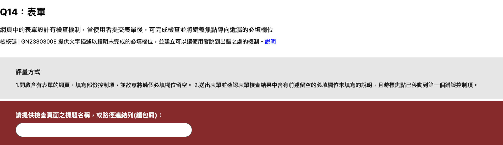

**評量項目**：網頁中的表單設計有檢查機制，當使用者提交表單後，可完成檢查並將鍵盤焦點導向遺漏的必填欄位

**檢核碼**：GN2330300E

**說明**：提供文字描述以指明未完成的必填欄位，並建立可以讓使用者跳到出錯之處的機制

### 評量方式
1. 開啟含有表單的網頁，填寫部份控制項，並故意將幾個必填欄位留空
2. 送出表單並確認表單檢查結果中含有前述留空的必填欄位未填寫的說明，且游標焦點已移動到第一個錯誤控制項

---

## Q15：響應式（RWD）設計

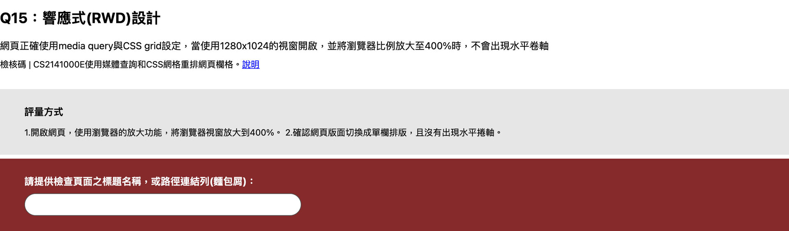

**評量項目**：網頁正確使用 media query 與 CSS grid 設定，當使用 1280x1024 的視窗開啟，並將瀏覽器比例放大至 400% 時，不會出現水平捲軸

**檢核碼**：CS2141000E

**說明**：使用媒體查詢和 CSS 網格重排網頁欄格

### 評量方式
1. 開啟網頁，使用瀏覽器的放大功能，將瀏覽器視窗放大到 400%
2. 確認網頁版面切換成單欄排版，且沒有出現水平捲軸
